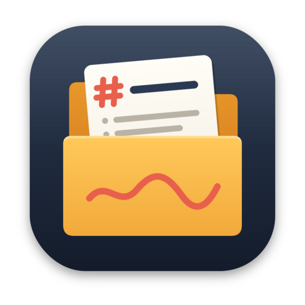

# Scratch Plus



A minimalist, offline-first markdown note-taking app for macOS, Windows, and Linux.

  

[Website](https://www.ericli.io/scratch) · [Releases](https://github.com/erictli/scratch/releases)

> **Scratch Plus is a community fork** of [erictli/scratch](https://github.com/erictli/scratch) that merges open pull requests from the upstream repository. See [What this fork adds](#what-this-fork-adds) for the list.

## Features

- **Offline-first** - No cloud, no account, no internet required
- **Markdown-based** - Notes stored as plain `.md` files you own
- **WYSIWYG editing** - Rich text editing that saves as markdown
- **Preview mode** - Open any `.md` file via drag-and-drop or "Open With" without a notes folder
- **Markdown source mode** - Toggle to view and edit raw markdown (`Cmd+Shift+M`)
- **Syntax highlighting** - 20 languages with GitHub-inspired color scheme
- **Mermaid diagrams** - Render flowcharts, sequence diagrams, and more in fenced code blocks
- **KaTeX math** - Render block `$$...$$` math equations
- **Wikilinks** - Type `[[` to link between notes with autocomplete
- **Slash commands** - Type `/` to quickly insert headings, lists, code blocks, diagrams, and more
- **Focus mode** - Distraction-free writing with animated sidebar/toolbar fade (`Cmd+Shift+Enter`)
- **Edit with Claude Code, OpenAI Codex, OpenCode, or Ollama** - Use your local CLI to edit notes with AI (including fully offline via Ollama)
- **Works with other AI agents** - Detects external file changes
- **Folders** - Opt-in collapsible folder tree with drag-and-drop to organize notes
- **Keyboard optimized** - Lots of shortcuts and a command palette
- **Customizable** - Theme, typography, page width, and RTL text direction
- **Git integration** - Optional version control with push/pull for multi-device sync
- **Lightweight** - 5-10x smaller than Obsidian or Notion

### What this fork adds

Merged from open upstream pull requests:

- **AI sidebar** - Chat with Claude Code, Codex, OpenCode or Ollama about the open note in a side panel, with a model choice per provider (`Cmd+Shift+A`) ([#213](https://github.com/erictli/scratch/pull/213))
- **Smart folders** - Create a folder whose name starts with `#` (for example `#area/finance`) to get a live view of every note with that tag ([#213](https://github.com/erictli/scratch/pull/213))
- **Edit a selection with AI** - Select text and let AI rewrite just that part from the editor toolbar, with reusable presets ([#166](https://github.com/erictli/scratch/pull/166))
- **Ollama via its HTTP API** - Fixes duplicated words when editing with Ollama ([#195](https://github.com/erictli/scratch/pull/195))
- **Back and forward** - Browser-like note history (`Cmd+[` / `Cmd+]`) ([#183](https://github.com/erictli/scratch/pull/183))
- **Go to note** - Jump to any note by name (`Cmd+G`) ([#186](https://github.com/erictli/scratch/pull/186))
- **Sidebar sorting** - Sort notes by title (A–Z, Z–A, with natural number order) or last modified (newest or oldest first) in Settings ([#210](https://github.com/erictli/scratch/pull/210))
- **Manual order with drag and drop** - Drag notes and folders into your own order with animated drop indicators; this switches sorting to "Manual" ([#156](https://github.com/erictli/scratch/pull/156))
- **Attachments in the sidebar** - Images, PDFs and other files in your notes folder appear in the sidebar with file type icons and a preview ([#153](https://github.com/erictli/scratch/pull/153))
- **Highlighting** - Mark text with `==text==` ([#214](https://github.com/erictli/scratch/pull/214))
- **GitHub-style alerts** - `> [!NOTE]`, `[!TIP]`, `[!IMPORTANT]`, `[!WARNING]` and `[!CAUTION]` blockquotes ([#174](https://github.com/erictli/scratch/pull/174))
- **Better code blocks** - Type three backticks plus a language and press `Enter`, or press `Cmd+Option+C`, to start a code block ([#205](https://github.com/erictli/scratch/pull/205))
- **Paste mode** - Choose whether pasted text is parsed as Markdown, pasted as plain text, or wrapped in a code block ([#162](https://github.com/erictli/scratch/pull/162))
- **Clipboard formats** - Copying puts both plain text and Markdown on the clipboard, so other apps paste it correctly ([#193](https://github.com/erictli/scratch/pull/193))
- **Spell check and autocorrect settings** - Turn either on or off ([#206](https://github.com/erictli/scratch/pull/206))
- **Custom commit messages** - Write your own message when committing with Git ([#157](https://github.com/erictli/scratch/pull/157))
- **New app icon** - An amber folder with a Markdown note

## Screenshot


## Installation

### macOS

**Homebrew (Recommended)**

```bash
brew tap erictli/tap
brew install --cask erictli/tap/scratch
```

**Manual Download**

1. Download the latest `.dmg` from [Releases](https://github.com/erictli/scratch/releases)
2. Open the DMG and drag Scratch to Applications
3. Open Scratch from Applications

### Windows

Download the latest `.exe` installer from [Releases](https://github.com/erictli/scratch/releases) and run it. WebView2 will be downloaded automatically if needed.

### Linux

Download the latest `.AppImage` or `.deb` from [Releases](https://github.com/erictli/scratch/releases).

### From Source

The installers above are the upstream version. To get the features of this fork, build it from source.

**Prerequisites:** Node.js 18+, Rust 1.70+

**macOS:** Xcode Command Line Tools · **Windows:** WebView2 Runtime (pre-installed on Windows 11)

```bash
git clone https://github.com/funky-monkey/scratch.git
cd scratch
npm install
npm run tauri dev      # Development
npm run tauri build    # Production build
```

## Keyboard Shortcuts

Scratch is designed to be usable without a mouse. Here are the essentials to get started:

| Shortcut          | Action                 |
| ----------------- | ---------------------- |
| `Cmd+N`           | New note               |
| `Cmd+D`           | Duplicate note         |
| `Delete`          | Delete note            |
| `Cmd+Backspace`   | Delete note            |
| `Cmd+P`           | Command palette        |
| `Cmd+K`           | Add/edit link          |
| `Cmd+F`           | Find in note           |
| `Cmd+Shift+C`     | Copy & Export menu     |
| `Cmd+Shift+M`     | Toggle Markdown source |
| `Cmd+Shift+Enter` | Toggle Focus mode      |
| `Cmd+Shift+F`     | Search notes           |
| `Cmd+R`           | Reload current note    |
| `Cmd+,`           | Open settings          |
| `Cmd+\`           | Toggle sidebar         |
| `Cmd+G`           | Go to note             |
| `Cmd+[` / `Cmd+]` | Back / forward         |
| `Cmd+Shift+A`     | AI sidebar             |
| `Cmd+Option+C`    | Code block             |
| `Cmd+B/I`         | Bold/Italic            |
| `Cmd+=/-/0`       | Zoom in/out/reset      |
| `↑/↓`             | Navigate notes         |

**Note:** On Windows, use `Ctrl` instead of `Cmd` for all shortcuts.

Many more shortcuts and features are available in the app—explore via the command palette (`Cmd+P` / `Ctrl+P`) or view the full reference in Settings → Shortcuts.

## Built With

[Tauri](https://tauri.app/) · [React](https://react.dev/) · [TipTap](https://tiptap.dev/) · [Tailwind CSS](https://tailwindcss.com/) · [Tantivy](https://github.com/quickwit-oss/tantivy)

## Contributing

Scratch is mostly stable and intentionally minimal, so I'm no longer monitoring issues and PRs regularly. You're welcome to open them, but I can't guarantee I'll get to everything, and it may take a while when I do.

What makes Scratch special is its minimal feature set and focus on user experience. We're not trying to build Obsidian or Notion, so not every feature will be a fit. If you want to make major changes or take Scratch in a new direction, you should fork it – it's MIT licensed.

**If you open a PR:** keep it small and focused, and try to address any CodeRabbit comments. I generally won't go back and forth with review comments – if I merge, I'll make any additional changes directly.

## License

MIT
